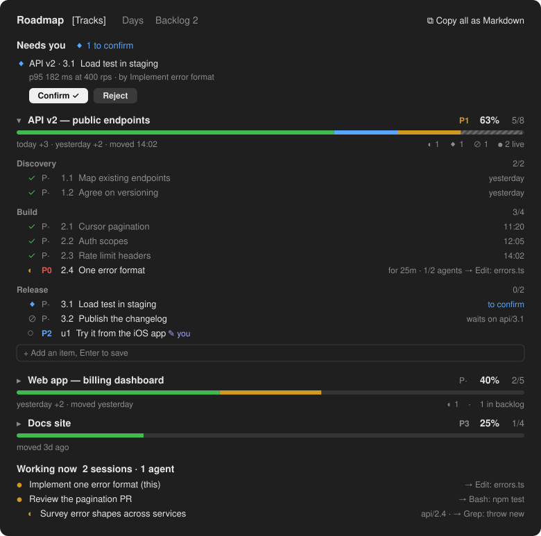

# Roadmap — shared planning state for coding agents

[](https://github.com/D4rxio/agent-roadmap/releases)
[](LICENSE)

A lightweight, file-based roadmap that lets multiple agents share the same execution plan, backlog,
priorities, dependencies and progress. Built for parallel Claude Code workflows, but the journal format
is tool-agnostic: any agent or script that can write a JSON file can take part.

Every Claude Code session reads the same state when it starts and writes back what it did; subagents
tick off their own steps; you see the whole picture in a side pane. You no longer have to piece together
what happened across five chats, and a fresh session knows where things stand.

<p align="center"></p>
<p align="center"><sub>Illustration with sample data.</sub></p>

## What's new in 0.6.0

- **Done, Backlog, Abandoned** — a track whose steps are all done says ✓ Done and goes to its own **Done**
  tab; abandoned tracks say where they stopped; you can close a track as done yourself.
- **A calmer list** — tracks keep one order you set (↑ ↓ ⤒), grouped by project; their actions wait under
  **⋯**; a priority shows only once set, in its colour.
- **Search** above the tracks — words in any order, accents ignored, refs included.
- **Reviews** — every round stays visible; a reviewer files findings as follow-ups; a Codex review run
  read-only (claudex-loop) is carried over from Codex's own session log with `--from-codex`.
- **Copy what you see** — the header's Copy follows the tab, and each item in Needs you has its own Copy.

## What's new in 0.5.1

- **Chains, easier to read** — ⤢ Wide opens the diagram in a pane of its own; this chat's step is ringed
  and named; hover a box for its whole title; Show done brings back folded steps.

Full history: [CHANGELOG.md](CHANGELOG.md).

**What it is not:** a project manager. There are no accounts, assignees, sprints, estimates, comments or
boards. It is a small shared state that agents and you both read and write — the plan, what is done,
what is next, what waits on whom — kept as plain JSON files. It aims to stay simple and readable: a
helper for the work, not a tracker. Integrations with issue trackers belong in a separate plugin built
on [the journal format](docs/journal-format.md).

- **Shared across sessions.** Start a new chat for every task: each one reads the roadmap when it starts
  and writes back what it did. Parallel sessions never overwrite each other.
- **Agents tick their own steps.** Put `#<track>/<id>` in a subagent's description (e.g.
  `#api/2.1 Map the endpoints`) and the step gets a green ✓ when the subagent finishes.
- **You stay in charge.** Agents report, you close: a step marked as a checkpoint waits for your
  **Confirm ✓**, and your priorities and backlog decisions always win over an agent's.
- **Memory for your agents.** A new session starts knowing the tracks, the open steps in priority order,
  what is blocked, what is set aside in the backlog, and which chat holds which step.
- **Works beyond Claude Code.** A small CLI gives Codex or any script the same roadmap from a terminal.

## Install

In a Claude Code terminal session:

```
/plugin install roadmap --marketplace D4rxio/agent-roadmap
```

Answer `y` to add the marketplace, then pick a scope. The desktop app's Code tab loads plugins installed
from a terminal at the user scope.

## Use

Ask Claude for a roadmap in plain words:

> lay out a roadmap track for the API work: discovery, implementation, release, with a checkpoint before release

or let it read and update one as it works. The pane opens on its own in the desktop app; anywhere else:

| Command | What it does |
|---|---|
| `/roadmap` | show or hide the pane |
| `/roadmap show`, `/roadmap hide` | open or close the pane |
| `/roadmap refresh` | read the roadmap again and redraw a blank or stale pane, without reloading the plugin |
| `/roadmap copy` | copy the whole roadmap as Markdown |
| `/roadmap band` | show or hide the one-line summary above the prompt |

### The pane

- **Tracks.** One card per workstream: progress bar (done, awaiting you, running, blocked), recent
  momentum ("yesterday +3 · moved 14:02"), the step to pick up next (**▸ next 2.3**: not waiting on
  anything, nobody on it, most urgent then most unblocking) and its longest open chain (**chain 4**, in
  steps — never days), and the steps when expanded, each with how many open steps wait on it (**⇢3**,
  down the chain and across tracks).
  - Hover a step for **Done ✓** to finish it in one press (your word, so it also closes a checkpoint),
    or click its icon to move it ○ → ◐ → ✓.
  - Click a phase's header to open or close it; phases with work left start open, finished ones closed.
  - Click the `P·` chip to raise its priority: P3 → P2 → P1 → P0.
  - Hover a step for **Copy** (`#track/id title`, ready for a prompt), **Pin** (this chat holds it), **Skip** (with a reason: it will not be done) and
    **Backlog** (set it aside), and on your own items **✎** (rename) and **✕** (remove).
  - Hover a track header for **⋯**: its actions open in a row under the title (see below); a finished
    track offers **Close** outright.
  - **+ Add an item** at the bottom of a track adds your own step, marked **✎ you**. Agents may refine
    it, but they never lose it.
  - **⧉ Copy as Markdown** copies one track; the header's **⧉ Copy tracks / backlog / done / days** copies
    what the tab shows.
- **Days.** Steps done per day over the last two weeks, and what happened each day: done, started,
  sessions, agents.
- **Chains.** One track at a time — this chat's by default, the others a click away — as boxes and arrows
  read top to bottom: the road ahead (finished steps that lead to nothing open are folded away), each
  dependency drawn once, the steps of other tracks it touches dashed, the next step outlined, the longest
  open chain in bold, this chat's step ringed in orange and named above the diagram (a text tree in the
  terminal); hover a box for its whole title, **Show done** to see
  the folded steps, and **⤢ Wide** to open the diagram alone in a wide pane (Esc closes it). No dates,
  no time axis. **⧉ Copy as Mermaid** gives the same diagram as a
  ```` ```mermaid ```` block that GitHub, GitLab and Gitea render — paste it into a PR, an issue or a doc.
- **Done, Backlog, Abandoned.** A track is **✓ Done** when every step is done, skipped or moved — done
  is done, whatever was decided on the way — and **Close** puts it in the **Done** tab. You can also close
  one as done yourself, open steps and all. **Backlog** is what will be done later (**↺ Restore** brings it
  back). **Abandon** drops an unfinished track; it shows where it stopped (`closed at 40%`) under
  Abandoned in the Done tab. **↺ Reopen** and **↺ Resume** bring a track back.
- **A track's actions** wait under **⋯** (shown on hover): Done ✓, Backlog, Abandon, **↑ Up · ↓ Down ·
  ⤒ Top**, Priority, ⌂ → another project, Copy title — so they never crowd the title out.
- **One order, like a kanban board.** Tracks are grouped under their project (this chat's first, tracks
  in no project last) and stay where you put them, the same in every chat: nothing an agent does moves
  them. A priority shows on the track only once set, in its colour (P0 red, P1 orange, P2 blue, P3 grey).
- **Projects.** Tracks belong to the repository they were laid out from (worktrees count as one). The
  pane shows this chat's project — plus tracks in no project — with a row to switch to another or **All**;
  hover a track header for **⌂** to move it to another project. Chats working in other projects stay out
  too. The band and the agents' summary stay on the chat's own project and name the others in one line; a
  dependency on another project's step says which project it is in.
- **This chat.** The step this chat holds, first thing in its pane; every pane marks which chat holds which step.
- **Needs you.** Checkpoints, proposed skips and moves, and reviews to confirm, each waiting for
  **Confirm / Reject**; failed steps; and steps left running with nobody on them (**◌ stale**).
- **Working now.** Live sessions and subagents and what each one is doing this moment.
- **↻ Roadmap updated.** A chat keeps the plugin code it started with. When the plugin's files on disk
  change (a working copy, or a folder in `CLAUDE_CODE_PLUGIN_DIRS`), the pane and the band say so, with a
  button that copies `/reload-plugins`: run it to load the new code in place, or restart the chat. A marketplace update installs into a new folder, which a running chat does
  not watch.

### Review policy

A plan can say how a step's work must be reviewed before it counts as done — on the step, or for the
whole track:

```json
"review": { "required": true, "independence": "cross-model", "mode": "adversarial" }
```

`independence` is `any`, `other-session` (not the chat that did the work) or `cross-model` (a different
model family: Claude builds, Codex reviews). New steps must say it; `{ "required": false }` opts out on
purpose. Keep it for the steps where a second look pays off — the complicated or risky ones. A worker's
done waits for a qualifying review, and each new done needs a new one. A plan can raise a policy but
never lower it. Because no process on one machine can prove which model wrote a review, a cross-model
pass comes to **Needs you** with the reviewer and the evidence, and your **Confirm ✓** closes it.

**A Codex review that cannot write.** When Codex reviews in a read-only sandbox — as
[claudex-loop](https://github.com/chaseai-yt/claudex-loop) runs it — it cannot write the roadmap. The host
carries the verdict over after each round:

```bash
node ~/.claude/mods/roadmap/cli/roadmap.mjs review <track>/<id> --from-codex <result.json | session id> [--follow-ups]
```

The verdict is read from Codex's own session log (`~/.codex/sessions`), not from the host's words:
APPROVED is a pass (with findings if any were noted), REVISE a fail, BLOCKED records nothing. It is dated
when Codex finished, so it never counts for work reported done after it, and it is recorded once.
`--follow-ups` files a passed review's findings as follow-ups.

### Tools the model gets

| Tool | Purpose |
|---|---|
| `roadmap plan` | lay out or re-lay one track: phases, steps with `why` / `scope` / `done_when`, checkpoints, `blocked_by` (loops are refused) |
| `roadmap step` | read one step's brief before working on it |
| `roadmap mark` | report a status with evidence (`skipped` needs a reason; `moved` needs a target step and a reason); propose a priority or backlog (`<track>/*` for a whole track) |
| `roadmap done` | close a step: what shipped, evidence, follow-ups (filed in the backlog) |
| `roadmap review` | record a review of a step's work: pass, findings or fail, with evidence |
| `roadmap status` | read this project's open steps (`all` for every project) and who is working on what |

## Other agents: the CLI

Codex, scripts or any agent that can run a command use the same roadmap through `cli/roadmap.mjs`
(Node ≥ 23.6, no dependencies; it runs the plugin's own model, so the rules are the same):

```
node cli/roadmap.mjs status                 # this project's open steps by priority (--all: every project)
node cli/roadmap.mjs step api/2.1           # a step's brief
node cli/roadmap.mjs json                   # the whole board, for analysis
node cli/roadmap.mjs plan api plan.json     # lay out a track from JSON
node cli/roadmap.mjs mark api/2.1 running
node cli/roadmap.mjs done api/2.1 --shipped "…" --evidence "…" --follow-up "title:P2"
node cli/roadmap.mjs review api/2.1 --verdict pass --evidence "…"
node cli/roadmap.mjs mermaid --out docs/roadmap.md   # what waits on what, as a Mermaid diagram
node cli/roadmap.mjs mark api/1 moved --to api/2 --reason "…"
```

[`cli/AGENTS-snippet.md`](cli/AGENTS-snippet.md) is a ready-to-paste block for an agent's `AGENTS.md`.
An agent running in a sandbox needs write access to the journal folder only (for Codex:
`[sandbox_workspace_write] writable_roots = ["<home>/.claude/roadmap"]`).

## Where the data lives

Everything stays on your machine, in `~/.claude/roadmap/`: one small JSON file per event, plus a
heartbeat file per live session. Nothing is sent anywhere. Other tools can take part by following
[the journal format](docs/journal-format.md).

To keep a roadmap with a project instead, set `CLAUDE_ROADMAP_DIR` to a folder inside the repository
(for example `.roadmap/`) and commit its `events/` folder: every event is its own file, so merging two
branches' roadmaps is merging two sets of files, with no conflicts. Keep `live/` out of git; it only says
which sessions are working right now.

## Why an event journal instead of one `roadmap.json`?

The obvious design is one file holding the current roadmap that every agent reads, edits and writes back.
With several sessions working at once, that loses work: two agents read version 12, both write their own
version 13, and the second write silently erases the first. Locks would fix it, but a crashed session
leaves its lock behind.

So nothing here is ever rewritten. Every change — a plan, a status, an added item, a priority — is a new
small file in `events/`, and the roadmap you see is computed from all of them:

- **No lost updates.** Two sessions writing at the same moment write two different files.
- **Order does not matter.** Events are applied by their timestamp, so files that arrive late, out of
  order or twice give the same roadmap. That is what lets a session that was offline for an hour, or a
  second machine syncing the folder, join without conflicts.
- **Rules live in the fold, not in the writers.** "A worker's `done` on a checkpoint waits for the
  person", "the person's priority beats an agent's", "your items survive a re-laid plan" are decided
  when the events are read. An agent cannot get around them by writing a different state.
- **History for free.** Every event says who did what and when, which is what the Days view shows.
- **Easy to version.** Point it at a folder in a repository and merging two branches is merging two
  sets of files.

## Develop

```
claude plugin validate .
claude plugin test .
```

How the modules fit together, where each rule lives and what to watch for when changing them:
[docs/architecture.md](docs/architecture.md).

To run your working copy instead of the installed one, add its folder to `CLAUDE_CODE_PLUGIN_DIRS`.

## Suggestions welcome

This started as a tool for one person juggling many parallel Claude sessions, and it is shaped by real
use. Ideas, rough edges and "it would be great if…" are all welcome: open an
[issue](https://github.com/D4rxio/agent-roadmap/issues) or a pull request. If you change the journal
format, update [docs/journal-format.md](docs/journal-format.md) and add a test in `tests/` — the board is
rebuilt from events in any order, so every new event kind needs a test that proves order and duplicates
do not change the result.

## License

MIT
