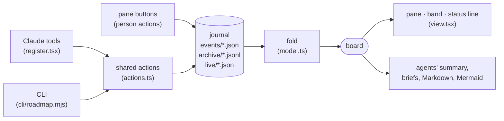

# Architecture

How the plugin is put together: what each module does, how a change flows from an agent or the
person to every pane, where each rule lives, and what to keep in mind when changing it. The journal's
file format is in [journal-format.md](journal-format.md); this page is about the code.

## The shape in one picture

Everything is derived from one append-only journal. Writers never edit state; they add an event. Every
reader folds all events into the same board, so two sessions writing at once cannot lose each other's
work, and every rule is enforced in one place: the fold.

## Modules

| File | Role | Runs where |
|---|---|---|
| `hooks/model.ts` | The fold and every rule; derived views (summary, brief, Markdown, Days, chains, Mermaid). Pure: no I/O. | plugin, CLI, tests |
| `hooks/actions.ts` | The agent-facing actions (plan, mark, done, review, step, status): validate input, refuse with a reason, return the events to write and the text to answer. Pure. | plugin tools, CLI |
| `hooks/register.tsx` | The Claude Code side: session lifecycle, journal I/O, tools and `/roadmap`, the person's actions from the pane, state, panes and the band. | plugin |
| `hooks/view.tsx` | Drawing: the pane (Tracks, Days, Chains, Backlog), the wide Chains pane, the band. Pure functions of `PaneData`. | plugin |
| `cli/roadmap.mjs` | The same actions and views from a terminal, for Codex, scripts and any other agent. No dependencies. | Node ≥ 23.6 |
| `types/index.d.ts` | The event union, the board's types, and the plugin's state contract. | everywhere |
| `tests/roadmap.test.tsx` | Fold rules, actions, pane behaviour, on both supported engines. | `claude plugin test` |

`model.ts` and `actions.ts` import nothing from the engine, so the CLI and the tests run the exact code
the plugin runs. Node strips the types itself; imports therefore name the `.ts` extension.

## `model.ts` — the fold

`fold(events, lives, now)` builds the board. It is a pure function: the same events give the same
board whatever order the files were read in, and a duplicate changes nothing. It runs in passes:

1. **Order.** Events are sorted by time; within one millisecond by kind (`session`, `plan`, `add`,
   `edit`, `agent`, `agent-end`, `step`, `triage`, `review`), step reports in the order work goes, then
   by their JSON text — one order for every reader.
2. **Events.** A `plan` lays out a track (keeping statuses for the same ids, the person's own items, and
   a floor of the strictest review policy each step was ever under). `step` events become words on a
   step. `session`, `agent`, `agent-end` and `review` are collected. An agent's end speaks for its step
   once every agent on that step has ended.
3. **The person's layer.** Adds and edits are laid over every plan; triage applies priorities, backlog,
   archiving, a track declared done, its rank in the list and project placement, the person's word
   beating an agent's (archiving, done, rank and placement are the person's alone). Tracks are then
   ordered by rank — where the person put them, else when they were created — one order for every chat.
4. **Projects.** A track's project is the person's placement, else the plan that created it, else the
   project most of its events came from — each event counted for the project its session was in *at
   that moment* (a session's project is a timeline of what it said and when).
5. **Moves.** Confirmed moves are followed to where the obligation ends up; that step answers for every
   step moved onto it, review policy included. A broken or looping chain ends nowhere.
6. **Each step.** Its words decide its status: a worker's `done` on a checkpoint, or out of `failed`,
   waits for the person; a worker's skip or move is a proposal; a confirmed move holds until the person
   changes it. Then its review policy (own, track's, floor, carried) and which reviews count: only ones
   written strictly after the last reported done, by an identity the policy accepts. A cross-model pass
   is `reviewed`, never `satisfied`: the person confirms it.
7. **Blocked.** A step whose prerequisites are not done (or skipped, or moved to a step that is done) is
   blocked.
8. **Live.** Heartbeats mark sessions live, give their activity and the step each holds; stale running
   steps are flagged.
9. **Chains.** For each open step, how many open steps wait on it; for each track, the next step and
   its longest open chain.

### Where each rule lives

| Rule | In |
|---|---|
| A worker reports, the person closes (checkpoints, failed, skips, moves) | per-step pass |
| The person's priority, backlog, archive and placement beat an agent's | `applyTriage` |
| A plan never lowers a review policy; policies are read failing closed | plan pass, `stricter`, `policyOf` |
| A review counts only for the work it reviews; cross-model needs a host-established identity | per-step pass, `qualifies` |
| No plan, add or edit sheds a policy floor; a move carries it | moves pass, per-step pass |
| Dependents wait on where a moved obligation went | blocked pass |
| A session's history stays in the project it happened in | `projectAt`, `inferProjects` |
| A board narrowed to one project keeps unplaced tracks and chats | `forProject`, `workingIn` |
| A track is done when every step is done, skipped or moved, or the person says so | `trackDone` |
| Only the person moves a track in the list; nothing an agent does reorders it | `applyTriage`, `rankFor` |
| A fail is a round at any time; a pass counts only for work reported done before it | `reviewAction` |

### Derived views

- `summary` — the agents' context: one project's open steps by priority, what is next, what waits on
  what, the other projects in one line.
- `brief` — one step: why, scope, done-when, review policy, what it waits on and unblocks.
- `trackMarkdown`, `boardMarkdown` — Copy as Markdown and `roadmap md`; `viewMarkdown` — what one tab
  shows (Tracks, Backlog, Done, Days), for the header's Copy.
- `days`, `doneSeries` — the Days view.
- `chainGraph` — the dependency graph: the whole board in, optionally one project and one track. With a
  track in focus: its steps in some chain and their neighbours in other tracks (every arrow between two
  steps on the picture kept); finished steps folded unless they stand right next to open work or are this
  chat's; arrows implied by a longer path dropped; the longest open chain marked.
- `mermaidOf`, `chainText` — the same graph as a Mermaid flowchart (deterministic) or a text tree that
  indents only at a fork, so a long chain reads down the page.

## `actions.ts` — what agents can do

Each action takes an `ActionContext` (the events, live files, time, who is writing and through which
front end, their project) and returns an `ActionResult`: `ok`, the text to answer, and the events to
write. Nothing is written when an action refuses, and the refusal says why and what to do instead.

| Action | Checks | Writes |
|---|---|---|
| `planAction` | review policy on new steps, no dependency loop, policy kept stricter | `plan` |
| `markAction` | known status; a skip needs a reason; a move needs a reason and a target that exists and does not loop (`checkMove`) | `step`, `triage` |
| `doneAction` | something shipped | `step`, an `add` per follow-up (backlogged) |
| `reviewAction` | a pass or findings only after the work was reported done (a fail at any time, as history); the CLI never records a review as Claude | `review`, an `add` per follow-up |
| `codexReviewAction` | a Codex review carried over from Codex's own session log: finished, not a Claude model, a claudex-loop result, recorded once, dated when Codex finished | `review` (`via: "codex-session"`) |
| `stepAction`, `statusAction` | — | nothing (a read; `step` may pin the chat) |

## `register.tsx` — the Claude Code side

- **Session start.** Reads the journal, detects the chat's project (the main repository's folder,
  through git's common dir), registers the tools and `/roadmap`, notes a fingerprint of its own code,
  and starts a 3-second tick: read new events, write the heartbeat, notice a code update, end finished
  agents, fold again when something changed.
- **Journal I/O.** `emit` writes one event file; `sync` reads new ones and archive bundles (a bundle
  read mid-write is read again until its header's count is met); `compact` folds old loose files into
  a bundle; `heartbeat` writes `live/<session>.json`.
- **Tools.** Each tool call runs a shared action through `act`, writes what it returns, and folds again.
- **The person's actions.** Buttons in the pane write events with `origin: "person"`: confirm, reject,
  skip, move (checked again at the moment of confirming), add, edit, triage, place, archive, pin.
- **State.** Per-chat UI state lives in named atoms (`board`, `view`, `expanded`, `focus`, `project`,
  `chainTrack`, …). The state contract is fixed when a chat starts, so a module reloaded into an older
  chat may not read keys added since: every key newer than the first release is read through a safe
  reader with a fallback and written with a quiet catch.
- **Diagnostics.** Each chat keeps `diag/<session>.log` (the last 300 lines): module loads, renders that
  fail, time out or run slow, and renders per minute — the engine reports a failed pane only to its
  debug log. Logs of chats gone for a week are dropped.
- **Panes.** `Pane` (the roadmap), `roadmap-chains` (the Chains diagram alone, opened wide), and the band
  above the prompt. Both panes build their data in one `paneData`; a render that fails, or whose data
  does not come within three seconds, says why. Each (re)load of the module asks its open panes to draw
  again, so no pane keeps buttons wired to the module before.

## `view.tsx` — drawing

Pure functions from `PaneData` to the engine's elements. `drawPane` lays out the header, the update
notice, This chat, Needs you and the current view (Tracks with its search and project groups, Days,
Chains, Backlog, Done); a track's actions open under its title from **⋯**; `drawBand` is the line above the prompt;
`drawChainsPane` is the wide diagram. Charts and diagrams are SVG strings (`progressSvg`, `sparkSvg`,
`chainSvg`) drawn by the `Svg` element; the terminal gets text instead, and so does a chain whose SVG
would pass the element's 131 072-character limit. Visual hierarchy: what is shown (the track, the
project) stands out, its actions (Copy, Wide, Copy as Mermaid) are dimmed.

## `cli/roadmap.mjs` — other agents

Loads the journal itself, runs the same actions, and writes events and a heartbeat. `review --from-codex`
finds a Codex session's log under `$CODEX_HOME` (by id, by a claudex-loop `result.json`, or by path inside
that folder) and hands it to `codexReviewAction`. Its identity comes
from the process tree (the nearest Codex or Claude process), or from Codex's sandbox where the tree
cannot be read; a bare `--actor` is a declaration. Its project is the repository it runs in, and
`status`, `md` and `mermaid` scope to it (`--all` for every project).

## Engine constraints worth knowing

- `$` may be passed only to top-level functions of the hooks module.
- `read($, atom)` must name an atom constant directly (a static scan checks which keys a module reads),
  so a generic "read with fallback" helper is not allowed — each newer key has its own safe reader.
- Before engine 2.1.295 a `Button` takes a single plain string; `Btn` switches on the engine version.
- On the desktop surface a truncating `Text` that holds styled `Text`s wraps, and a wrapped row breaks
  the pane's scrolling; `Line` lays styled parts side by side and cuts only the main one. A test guards it.
- A hover-revealed `Box` (`display: 'none'`) must not carry its own key.
- The `Svg` element draws images, or a script-less frame (`isInteractive`) for hover titles, up to
  131 072 characters of source; it has no scripting, so dragging or zooming a diagram would need a drawing
  module of its own.
- Older engines refuse a pane with more than 100 000 characters of text: keep text views compact.

## Tests

`claude plugin test .` runs the suite; run it with both the app's engine and an older `claude` on PATH.
Tests mock the engine's events (`fs.*`, `process.run`, `session.id`, `ui.copy`, …), control the clock
by holding `clock.every`, and simulate an older chat by denying `state.get`/`state.set` for newer keys.
Changes to rules are checked by mutation: undo one rule in a copy and confirm a test fails.

## Adding things

- **A new event kind.** Add it to the union in `types/index.d.ts`, handle it in the fold (and in the
  same-millisecond order), describe it in `journal-format.md`, and test that event order and duplicates
  do not change the board.
- **A new state key.** Add it to the state contract in `types/index.d.ts`, read it through its own safe
  reader with a fallback, catch its updates, and extend the older-chat test.
- **A new view.** A pure function of `PaneData` in `view.tsx`, a tab in the header, and a pane test on
  both surfaces (desktop draws SVG, the terminal text).
